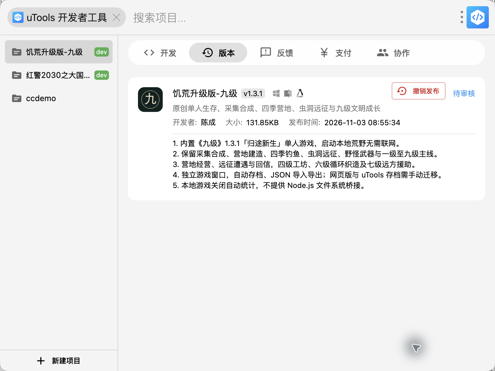

# 九级 uTools 1.3.1 发行记录

- 应用名称：饥荒升级版-九级。
- 游戏版本：1.3.1「归途新生」。
- 查询指令：饥荒升级版-九级、九级、九级生存。
- 应用 ID：`zlvyqyjb`，已独立创建。
- 当前状态：2026 年 11 月 3 日 08:55:34 已提交市场，平台回读为 **待审核**；尚未确认审核通过或正式上架。
- 正式安装包：`Jiuji-v1.3.1-utools.upxs`，131,852 字节，由 uTools 7.8.0 开发者工具生成。
- SHA256：`63c49887ab06d277b904a6e2c414eaf635ec2bdca1d60d084818fb77caca8436`。
- [安装包与源代码发行](https://github.com/chencheng666/jiuji/releases/tag/utools-v1.3.1)；发行包为送审预发布版。
- 已填写并回读版本说明、应用介绍，上传三张真实游戏截图。

- 不修改《大国崛起》的应用记录、安装包或服务器文件。

## 游戏介绍

在一片陌生的荒野醒来，从捡起树枝、制作石斧开始。采集材料、合成工具、建造营地，为夜晚准备食物与营火。春夏秋冬带来温度、雨水与不同的生存需求，还可以钓鱼、烹饪、种植、晾晒和追肥。

穿过虫洞探索苔痕林海、烬岩荒原与霜月冻土，面对不同的野怪和守卫，选择弓、锤、长矛或法杖；也可以通过工程和生态修复获得关键构件。远征遭遇提供即时回报与延迟回信，回到营地后再兑现投入。

成长不止于战斗。物质与意识双轨科技贯穿一级至九级，四级共振工坊、五级构件修缮、六级循环织造与七级远方援助会持续改变营地生活。支持单人本地游戏、自动存档、JSON 备份及旧版存档迁移。

《九级》是独立原创项目，玩法灵感来自《饥荒》等作品，并非《饥荒》官方版本。联机与微信小游戏仍在规划中。

试玩：https://www.daguojueqi.site/jiuji/

源码：https://github.com/chencheng666/jiuji

公众号：数字机器莱西奥

## 首发版本说明

1. 内置 1.3.1 游戏资源与本地音效，启动荒野无需联网。
2. 提供独立可调整大小的游戏窗口，重复进入可返回同一窗口。
3. 保留四季、钓鱼、虫洞、野怪与武器、营地经营、远征回信和九级主线。
4. 游戏不自动联网统计，不暴露 Node.js 或全盘文件访问桥接。
5. 入口提供主动打开的在线试玩、作者官网与 GitHub；本机存档可从游戏菜单导出、导入。

## 验证范围

- 84 项规则与窗口行为测试通过，语法检查通过。
- 浏览器直接通过本地 `file:` 加载离线 HTML 成功，地图、人物、建筑和 SVG 资源正常显示。
- 实际采集树枝与燧石、制作石斧、自动保存、刷新续玩与 JSON 导出通过。
- 导入正常流程生成的六级循环织造及远征遭遇存档通过。
- 三张配图为离线浏览器中的真实游戏截图，已随版本一起提交。
- macOS / uTools 7.8.0 原生启动、画面、树枝与燧石采集、石斧合成、存档导出解析和重新导入通过。窗口复用仅有单元测试覆盖。
- Windows、Linux 原生 uTools 尚未真机验证。
