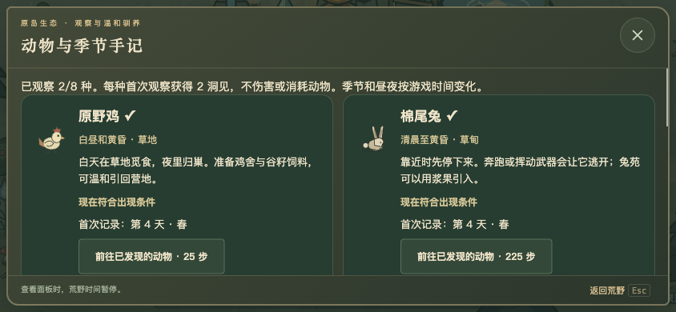
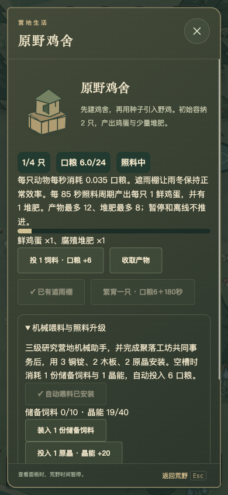
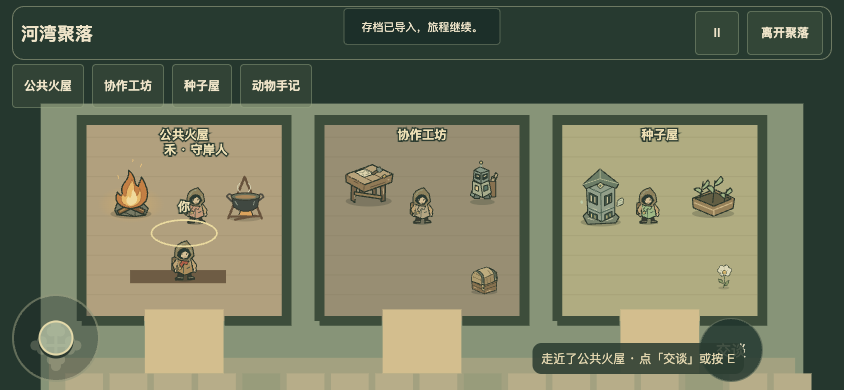
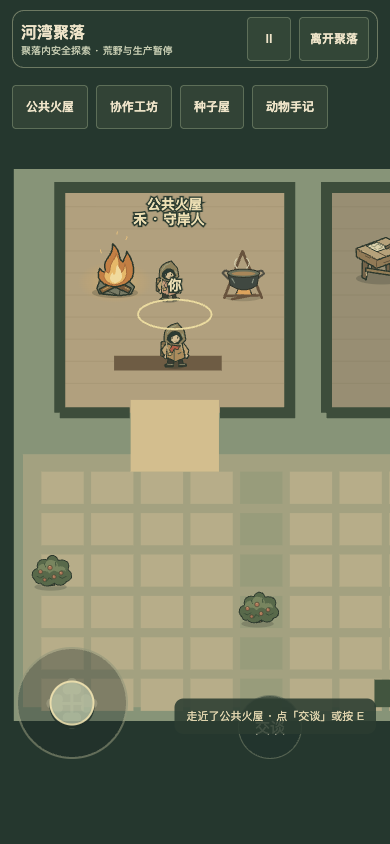
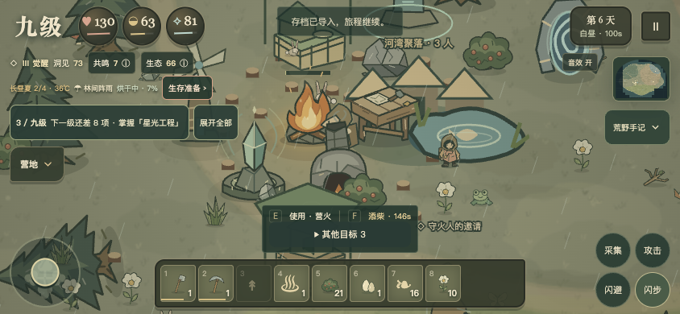
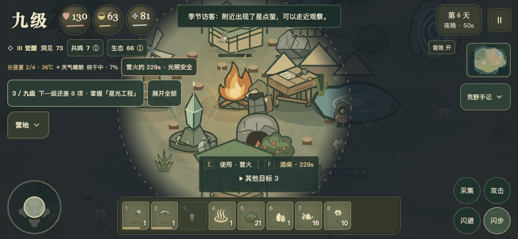

# 九级 3.2.0 · 荒野邻居

本轮完成本地源码与离线 ZIP 候选，不代表腾讯云、GitHub 远端或任何商店已经更新。Windows/macOS 原生安装包和 TapTap 真机未在本轮验证。

## 可以怎样玩

1. 白天走近鸡、兔、栗鼠或蝴蝶，选择安静观察。每种首次记录获得 2 洞见，重复观察不刷奖励。
2. 在研究台掌握「万物观察 → 温和驯养」，合成并建造鸡舍或兔苑。准备 2 种子引领鸡、2 浆果引领兔；动物会沿通路自行回舍，在途占用容量，遇险先等待。
3. 用 2 种子、4 纤维制作 2 份谷籽饲料。每份投入 6 口粮，照料后收鸡蛋、自然脱落兔绒和少量堆肥。营火煎蛋补给饱食和生命，兔绒可制保暖披肩。
4. 用木板与纤维扩建遮雨棚，将容量从 2 只升到 4 只；两只动物、空位与口粮支持繁育。缺粮只暂停照料，离线、暂停、离开原岛都不会生产或饿死。
5. 走近聚落选择「走进聚落」，用摇杆、WASD 或点地面进入公共火屋、协作工坊、种子屋。走近居民后交付真实材料，完成共同事务。进入时室外暂停，离开返回门前。
6. 三级掌握营地机械助手，并完成任一聚落工坊事务后，可安装自动喂料器。储备饲料与原晶都要真实投入，每次补料消耗 1 份饲料、1 晶能。

养殖是可选生活路线，不额外阻断原有一级至九级的晋升条件。季节稀有访客也不要求玩家守着现实时间上线。

## 八种邻居的日历

| 动物 | 出现条件 | 互动 |
| --- | --- | --- |
| 原野鸡 | 四季白昼、黄昏 | 观察、用种子引入鸡舍 |
| 棉尾兔 | 四季清晨至黄昏 | 观察、用浆果引入兔苑 |
| 松果栗鼠 | 春夏秋白昼 | 观察，急跑会惊动 |
| 晨露蝶 | 春夏白昼 | 花丛观察 |
| 雨铃蛙 | 春夏雨中、雨停后短时间 | 池边观察 |
| 星点萤 | 夏季黄昏、夜晚 | 水边观察，微光不提供安全照明 |
| 落叶刺团 | 秋季黄昏 | 观察，惊动后避开 |
| 迁徙花鹿 | 每季最后一天、下一季第一天的日间 | 林缘观察 |

动物手记列出出现条件；前往按钮只指向已经探索过的资源格，不泄露未探索位置。

## 昼夜与手机操作

- 夜色光圈与真实照明保护范围一致，营火虚线只是范围提示；火炬仍可支持夜间探索。简化渲染保留光圈，不用全屏浅遮罩抹平昼夜差异。
- 生存准备显示营火预计续航，计入白昼、黄昏与当前雨势的消耗差异。缺光先有 7 秒缓冲，不新增额外减速或伤势。
- 原岛远处增加两只领地性林猪，沿用冲锋预警、侧闪和诱饵；出生地、聚落和虫洞不增加突袭压力。
- 照料、房屋导航、关闭按钮按触屏使用设计；次要升级和清空管理折叠，内容区域可滚动。
- 修正聚落导航遮挡对话标题与关闭按钮的层级问题；矮横屏屋内镜头为导航预留空间。
- 游戏区域屏蔽长按选字、系统菜单、拖图和全选；种子等真实输入框仍保留编辑。

## 验收记录

2026-11-10 本地完成：

| 检查 | 结果与边界 |
| --- | --- |
| `npm test` | 202 项通过，包含旧档迁移、动物时段、真实诱饵、容量、饲料守恒、满背包、繁育、自动喂料、聚落寻路与暂停、非法存档、简化夜色、长按保护 |
| `npm run check` | JavaScript 语法检查通过 |
| `npm run test:journey` | 一级至九级正常资源主线通过 |
| `npm run test:coexist` | 共生远征正常资源流程通过 |
| `npm run test:robotics` | 真实采集、返程卸货、充电流程通过 |
| `npm run test:countryside` | 一级正常采集接续鸡兔入舍、鸡蛋烹饪、兔绒披肩、工坊事务、自动喂料；没有注入物资、等级、坐标或时间 |
| 浏览器页面 | Ego Lite 的 390×844 竖屏、844×390 横屏；手记、照料、聚落进出、房屋导航与关闭按钮；未发现横向溢出 |
| 离线 ZIP | 本地文件断网启动，导入正常资源养殖存档、收取产物、导出存档并重新解析通过 |
| 离线静态检查 | 177 个文件，联网实现和外链移除检查通过 |

测试产物位于本地 `artifacts/countryside-20261110/`，离线 ZIP 与哈希报告位于 `artifacts/desktop-downloads/`。不把这些结果称为 iPhone、反馈型号手机或 TapTap 客户端真机验收。

## 页面截图

动物手记与鸡舍照料使用正常资源旅程存档；昼夜对比和聚落内景使用隔离画面测试档，以定位光圈、镜头和布局。后两类图片不作为正常资源流程的证据。

