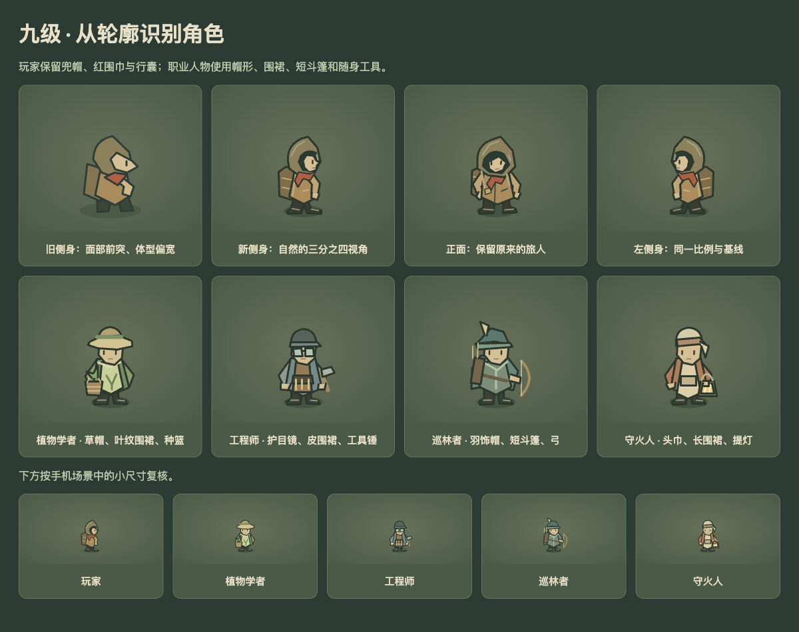
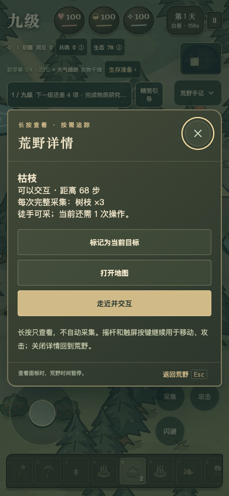
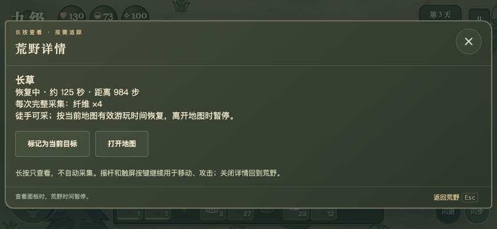
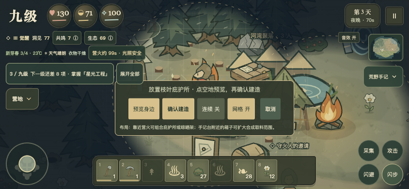
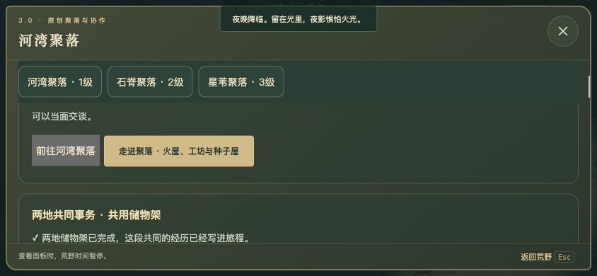
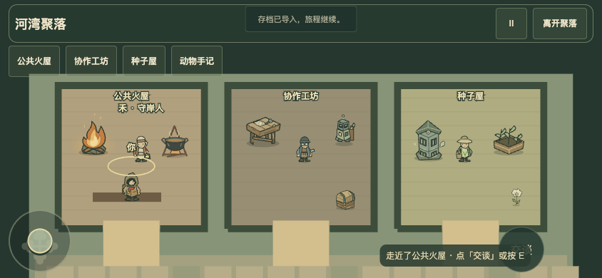

# 九级 3.3.0 · 营地协作

当前为本地候选，未部署腾讯云、推送 GitHub 远端或更新商店。本轮不更改已有商店审核包。

## 本轮变化

- 手机长按资源或建筑约 0.5 秒查看详情；滑动、第二触点、失焦会取消。短按保留原走近逻辑，摇杆不受影响；修复长按松手误触弹窗按钮的问题。
- 亲手采过的树、矿、草丛留下地图足迹，显示采空或恢复状态。可标记一个已发现目标，不自动移动。每张常驻地图最多记住最近 160 处；旧档从本轮游玩开始记录，不伪造旧历史。
- 庇护区：庇护所 150 步内有燃烧营火，所内晾干速度 +50%，不扩展安全光照。
- 加工区：晾晒架 155 步内有燃烧营火，晾晒速度 +25%，不额外产物；熄火停止加速。
- 储物区：箱子 150 步内有远征手记台，此箱合成取料范围从 180 扩到 220 步；实际转移仍须走近。校验与扣料使用同一规则。
- 组合预览和实际加成一致，同类不叠加。手机点击空地先预览，再按确认建造；取消不扣材料。原有连续播种保留快捷操作。
- 四位伙伴对雨天、受伤、冬前、动物记录和共同事务各有回应。聚落居民也会谈到正在进行的两地协作。
- 河湾用 6 木材、6 纤维打包协作物资箱，带到二级开放的石脊，再交 6 石料、2 燧石共同完成储物架。回礼仅一次：图纸 1、饲料 3、洞见 4，两地好感 6、安稳 5。无倒计时与阵营惩罚，物资箱在探索模式倒下时不会掉落。
- 玩家侧身改为自然三分之四视角，保留兜帽、红围巾与行囊，统一正侧比例与落脚点。移动、采集和聚落内部使用一致朝向。
- 植物学者用草帽、叶纹围裙和种篮；工程师用护目镜、工具围裙与锤；巡林者用羽饰帽、短斗篷和弓；守火人用头巾、长围裙和提灯。职业轮廓与玩家区分，伙伴面板也使用真实角色头像。

## 验收

2026-11-10：216 项规则测试及语法检查通过。正常资源旅程从一级采集接续，完成建筑组合、真实箱内存料、两地付料和物资箱交付、地图标记和存档回读；没有注入物资、等级、位置或时间。原九级主线、共生远征、独立机器人和鸡兔养殖流程通过。

Ego Lite 检查 390×844 竖屏、844×390 横屏的长按、松手误触、详情、地图记忆、放置预览、角色素材与聚落对话，未发现横向溢出。离线候选用本地文件启动并导出存档，静态检查移除了联网实现与外链。未进行 iPhone、反馈机型或 TapTap 真机验收，也未构建原生安装包。

本地结果与日志：`artifacts/camp-living-20261110/`；离线 ZIP：`artifacts/desktop-downloads/Jiuji-v3.3.0-offline.zip`。

[讨论落实与后续清单](../../玩法讨论与后续清单.md)

## 截图

详情与足迹来自实际操作和正常资源流程存档；角色内景截图使用隔离画面档，素材对照是同一套 SVG 的展示页。

