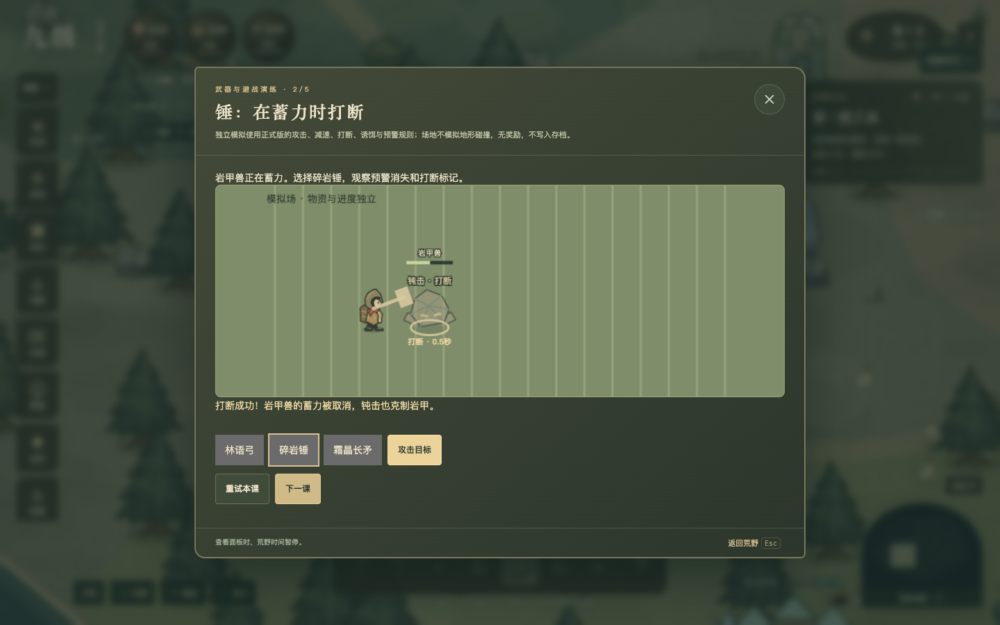
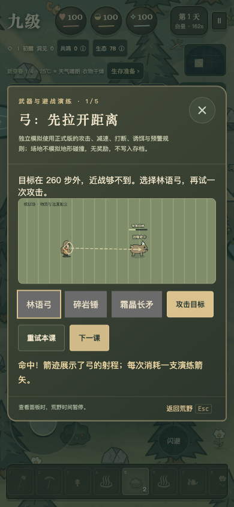
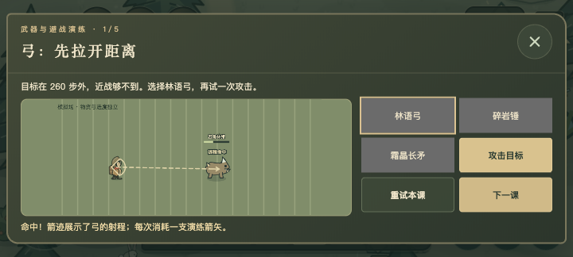
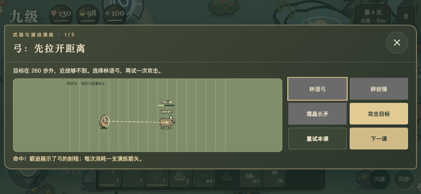

# 九级 3.4.0 · 流畅与交锋

本地验收候选。尚未部署腾讯云、推送远端或更新任何商店。此轮没有改动《大国崛起》、uTools 或 TapTap 审核中的包。

## 针对 2K 屏移动卡顿

目前渲染器为 Canvas 2D。粉丝的反馈值得排查，但没有拿到其设备、浏览器与诊断，不能直接断言“缺少 WebGPU”就是卡顿原因，也不能声称已在该设备解决。

本轮减少可确认的重复工作：

- 将加载完成的 SVG 场景元素按尺寸栅格化并复用；手机缓存最多 12 MiB、桌面最多 24 MiB，使用 LRU 释放旧缓冲。分配失败回退原图，不反复尝试同一失败尺寸。
- 小地图复用预缩小地形；换地图主动释放旧图。
- 均衡模式限制桌面场景约 250 万像素，清晰优先保留原约 400 万上限，流畅优先约 150 万。手机相应上限为 150/150/90 万，仍有 1.5 倍像素密度上限。文字与按钮使用原生界面，不跟着变糊。
- 均衡夜色缓冲在桌面使用 0.65 倍边长；照明位置、安全半径和生存规则保持一致。
- 帧节拍保留迟到余量；后台停止场景和 HUD 绘制；不变的任务和生命界面复用现有 DOM。
- “菜单 → 操作与画面”可查看近期帧率、CPU 绘制 P95 与慢帧，导出本地 JSON。暂停、后台不计；更改画质或上限后重新采样。没有新增网络上报。

### 本机对比

固定种子 34、353 个节点、2560×1440 视口；白昼和夜晚使用同一条正弦移动路线，各预热 30 次，再连续绘制 240 次。以下为主线程提交绘图命令的 CPU 耗时，**不是整机 GPU 耗时或实际游戏帧率**。

| 场景 | 3.3 中位数 / P95 | 3.4 均衡中位数 / P95 | 3.4 清晰中位数 / P95 |
| --- | --- | --- | --- |
| 白昼 | 1.2 / 1.8 ms | 0.6 / 0.8 ms | 0.6 / 0.9 ms |
| 夜晚 | 1.2 / 1.8 ms | 0.6 / 0.9 ms | 0.6 / 0.9 ms |

均衡场景缓冲从 2560×1440 降为 2108×1185，像素量减少约 32%。此场景缓存约 1.2 MiB，预热后复用已有精灵。原始结果见 [性能对比.json](性能对比.json)。

Ego Lite 连续 RAF 测试出现约 1 秒调度间隔，本轮未取得可靠的前台持续 FPS 对比，不能据此承诺“稳定 60 帧”或“FPS 翻倍”。需要粉丝在同一设备更新前后，使用相同画质、路线和存档复测；诊断入口已准备好。

## 武器更容易看懂

- 林语弓：弓弦、箭迹、箭头与“远程命中”。伤害仍在正式命中时结算，余迹不延迟伤害。
- 碎岩锤：独立挥击、落地冲击环，“钝击·打断”与实际剩余打断秒数。
- 霜晶长矛：短突刺、冰晶痕迹与实际减速秒数。
- 减少动态模式保留静态语义，关闭非必要动作，不增加震屏或高频闪烁。

## 五课武器与避战演练

从暂停菜单或武器图鉴进入：射程、打断、减速、诱饵绕行、冲锋侧移。演练复用正式攻击、克制、冷却、诱饵与怪物预警规则；模拟场地不模拟地形碰撞。

不要求先拥有武器，不扣真实库存，不给刷取奖励，不改当前地图、生命或旅程存档。每课可重试，关闭即可回到原旅程。

手机竖屏上下排列；横屏、324 像素高的宿主短横屏采用场景在左、操作在右的布局。没有新增常驻 HUD，按钮至少 44 像素。浏览器模拟检查通过，不等同于 TapTap、iPhone 或反馈机型真机验证。

## 验收与交付

- 226 项测试、脚本语法检查通过。
- 一级至九级主线、共生远征、独立采集机器人、季节动物与养殖、营地布局与两地协作的正常资源旅程通过。
- 浏览器逐项完成五课：射程命中、打断蓄力、霜晶减速、诱饵绕行、侧移避开冲锋。
- 390×844、844×390、720×324：横向溢出为零，短横屏场景与六个操作按钮同屏。
- ZIP 从本地文件启动、模拟射击与存档导出通过；177 个离线文件通过联网能力静态检查，浏览器未观察到 HTTP(S) 资源请求。
- 离线包与哈希见项目 `artifacts/desktop-downloads/portable-report.json`。本轮未编译 Windows/macOS 原生安装包。

下一批：园丁与搬运机器人，再推进聚落生活事务；继续保护旧存档、真实材料消耗和手机视野。

## 实机画面

