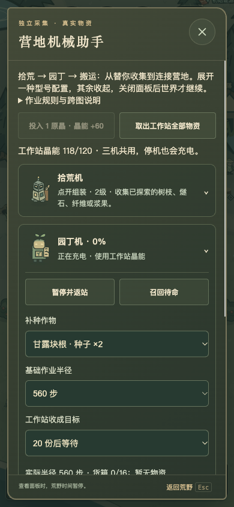
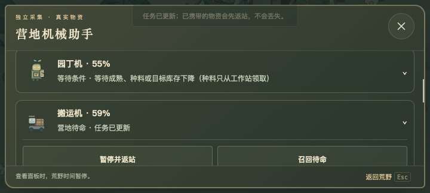
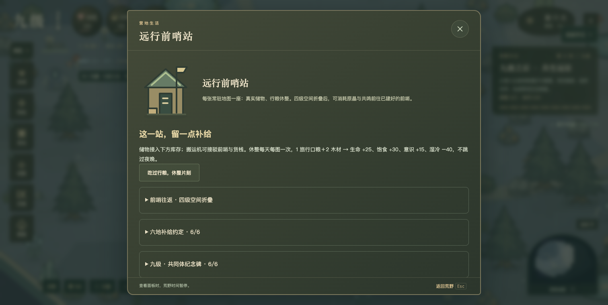
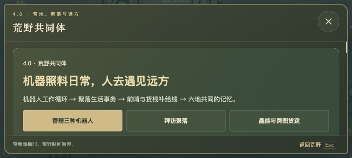
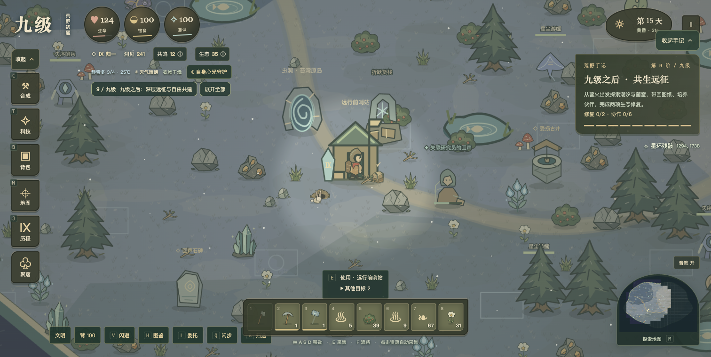

# 九级 4.0.0 · 荒野共同体

核对日期：2026-11-12。4.0 网页已部署腾讯云并完成公网文件与实际操作核对。本轮未推送 GitHub 或提交商店，官网与原生安装包继续保留原发布版本。

这次把公众号中的机器人协作、聚落生活与跨图经营连成可玩的循环。先从育苗床和真实货物开始，再把补给带到远方；九级之后也有六地共建可以接着做。

## 现在能玩什么

### 园丁与搬运机器人

二级研究「地脉采集＋万物观察 → 营地机械助手」，在文明设施里建机器人工作站。每图一站，每种型号各一台，六张常驻地图最多 18 台。原有拾荒机保持原任务。

- 园丁机：二级，另需共生实践；从工作站领取种子、种荚或荧光花，到已探索的林海育苗床播种，成熟后装箱运回。育苗床仍需先完成首项远征委托，生长时间按原季节规则。机器人不加速成熟、不从玩家背包偷偷拿种料；缺料、没有苗床或收成达标会等待。
- 搬运机：三级。指定本地起点、终点、物品、源仓保留量、每趟批量和终点目标库存。支持箱子、工作站、育苗床、晾晒架、折跃货栈、装配台、蒸汽工坊和前哨。到源仓才实际取货，终点临时填满或改变任务时，余货随车回站。
- 两种新机与拾荒机共用晶能：1 原晶补充 60 能量，上限 120。充电、低电返站、遇险返回、手动召回、断路等待和满仓保货沿用同一规则。停机也会在站内充电。
- 每台可二选一改装：加宽货箱（16 → 24 份，2 铜锭＋2 木板）或远行导航（所选半径 +240 步，3 原晶＋2 荧光花）。停机卸空后靠近改装；回收返还机体及模块材料，电量不折回原晶。
- 配置与库存按需展开，改设置后保持展开和滚动位置。面板、后台、离线及不在场地图均暂停机器人，不补算离线生产。已有晶能物流仍按原工业规则推进。

### 聚落里有来信，也留下共同的生活

三个聚落各有两段生活事务，共六段；可以延期，不增加现实倒计时或阵营惩罚。

- 河湾：补好干柴雨棚，准备送往石脊的饭篮。
- 石脊：修好搬运小车，接收河湾饭篮、共同准备货箱。饭篮为真实任务物品，亲自携带到当地交付，不会因探索模式倒下掉落。
- 星苇：补充换季种子匣，再与已经完成真实收成运回的园丁机一起布置公共园地。

相遇并开放等级后，居民会托人带来一次提示。交付需要当面进行，使用真实材料、只发一次回礼；每段有洞见、好感与安稳提升。已有居民日程继续运行，搬运人会走到新陈设附近整理；室外与聚落院子都留下雨棚、小车、苗圃或货箱。

### 小路、前哨和六图经营

- 二级「碎石小路」：2 石料一段，人和机器人在小路范围内移速 +15%，不叠加，不跨水；每图最多 160 段。手机沿用先选位置、再确认扣料的建造方式。
- 三级「远行前哨站」：每张常驻地图一座，10 木材＋6 木板＋8 石料＋8 纤维，需要共生实践。可存取物品、就近取料，并作为搬运起点或终点。
- 前哨休整：每图每天一次，1 旅行口粮＋2 木材，生命 +25、饱食 +30、意识 +15、湿冷 −40，不跳过整夜；附近有危险时不能休整。
- 四级空间折叠后：起终点都已建前哨、且两端安全，消耗随身 1 原晶＋2 共鸣折跃往返。只连接亲自到过并建设的地图，普通虫洞仍然免费。
- 经营总览列出六地前哨、货栈、补给和共建进度。搬运机接驳本地库存，已有折跃货栈承接跨图运输，没有远程共用背包。

### 九级之后与发现记录

- 「六地补给约定」：四级开始，每图前哨投入 3 木材、1 旅行口粮；投入的是公共项目材料，不可再从个人库存取回。六地完成获得 2 图纸、6 洞见。
- 「共同体纪念碑」：九级且上述约定完成后，每图投入 2 原晶、2 木板。六地完成获得 1 共识印记、10 洞见；各地都有纪念陈设，不改变已有九级结局。
- 采集图鉴根据首次亲手采得的记录点亮，机器人不替玩家完成首次发现；配方来源追踪和战斗教学继续可用。
- 荒野编年史保留最近 60 条生活与共建记录，可导出本地 JSON 回顾，不上传，也不是云存档。
- 玩家待机会短暂向左右张望；不改变真实朝向、攻击和碰撞。减少动态时关闭张望表现。

## 粉丝建议的取舍

| 建议 | 本轮处理 |
| --- | --- |
| 自动化、减少重复采集 | 实装园丁、搬运机及模块升级，保留原拾荒机；真实材料与电量闭环。 |
| 人物待机、采集动作 | 增加短暂张望；已有弯腰采集与方向动作继续保留。 |
| 取消采集按键 | 保留手机明确动作入口，继续支持点击资源自动走近采集；不强迫玩家精确点中小资源。 |
| 图鉴需要收集 | 新增发现式采集图鉴；已有动物观察与记录仍保留。 |
| 翻滚、跳跃、格挡 | 保留现有闪避、战术格挡与避战教学；荒野跳跃、实时格挡未加入，先不再增加常驻触屏键。 |
| 六图合一 | 保留分图加载，实装前哨网络与经营总览；合图会牵涉手机内存、寻路、旧存档及全部地形坐标，本轮不强改。 |
| 服装自定义、完整角色状态面板 | 继续保留现有服装/护甲效果与职业服饰；完整外观自定义未做。 |
| 更多树种、林下隐蔽、夜怪重做 | 已有昼夜火光与战斗差异继续保留；整套森林生态、潜行和夜怪重做不混入本轮，不把简单换图当作新机制。 |

## 验收结果

- `npm test`：242 项通过；`npm run check` 通过。
- 新增 16 项共同体规则测试：真实播种、抢先种植、途中改任务、两机库存守恒、缺料与满仓、未探索与危险路径、旧机器人迁移、在途存档、前哨条件与扣料、防重复共建、UI 渲染等。
- 正常资源旅程：从一级真实采集/晋升、远征取得构件开始，建育苗床和两种机器人，真实充电、播种、收获、搬运 3 块根，完成河湾和石脊四段事务；未注入材料、位置、等级、时间或电量。
- 六地旅程：沿用完整一级至九级主线，关闭结局创造模式后真实备料、建六站、完成两轮共建，核对一次前哨折跃消耗 1 原晶＋2 共鸣。
- 320×568、390×844、720×324、844×390、1500×760 检查：无页面/面板横向溢出，面板在视口内滚动，关闭按钮 44×44。手机存入 5 种子、修改设置保持展开、编年史导出通过。
- 3.4 旧检查点载入后背包、等级、到访地图不变，补入共同体数据。
- 离线 ZIP 构建与联网能力静态检查通过，断网本地文件启动、导入与共同体页面可用。

移动端以上为 Ego Lite 浏览器模拟，未做实体 iPhone/Android、TapTap 客户端或 Windows/macOS 原生安装验收。没有声称所有设备稳定 60 帧。本轮只交付本地源码、可玩预览与离线 ZIP，没有执行生产、官网、GitHub 或商店发布。

## 试玩与文件

运行 `npm run dev`，默认 http://127.0.0.1:4317 。本轮验收预览端口 4340。

离线包：`artifacts/desktop-downloads/Jiuji-v4.0.0-offline.zip`。解压整个 Jiuji 文件夹后打开 index.html。

存档仍采用 v9 扩展结构，3.4 旧档可接续；新型号和前哨写入后的新档不保证旧客户端能读，回退前请使用升级前备份。

- [浏览器布局验收](浏览器验收.json)
- [旧档迁移验收](旧档迁移验收.json)
- [正常资源机器人旅程](正常资源旅程结果.json)
- [六地共建旅程](六地共建旅程结果.json)
- [离线构建报告](离线构建报告.json)
- [断网实际运行与播种返站](离线运行验收.json)

## 代码入口

- `robotics-data.js / robotics.js / robotics-ui.js`：型号、模块、真实货物与移动状态机。
- `community-data.js / community.js / community-ui.js / community-view.js`：聚落来信、前哨、共建与编年史。规则通过 bindCommunity 注入，避免入口加载顺序造成循环依赖。
- `survival.js / homestead.js`：建造、旧档扩展校验、近距仓储取料与统一游戏步进。
- `village-life.js` 与两个聚落绘制模块：原有居民日程接上共同事务反馈。
- `tests/community*.mjs`：规则与两条正常资源旅程，可独立复跑。

## 蒸汽与战斗补充（2026-11-12）

加入三级蒸汽工坊、搬运供料和出货、翻滚近战突进、野猪击退、三类夜影和初级木鸡舍食碗。完整规则、建议取舍与本轮验收见 [补充说明](蒸汽与战斗反馈/说明.md)。本轮规则检查 251 项通过；一级正常资源流程真实产出两块木板并由搬运机入库。网页生产状态以发布回执为准。
