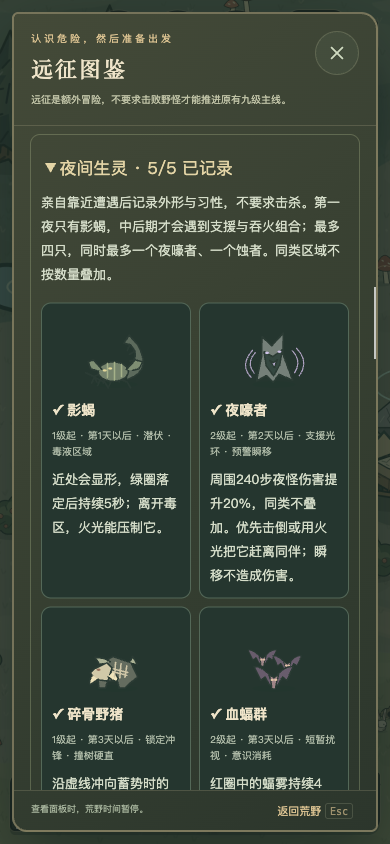
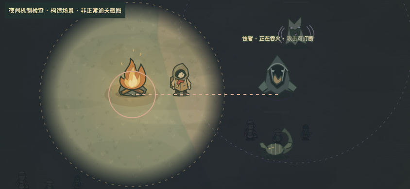
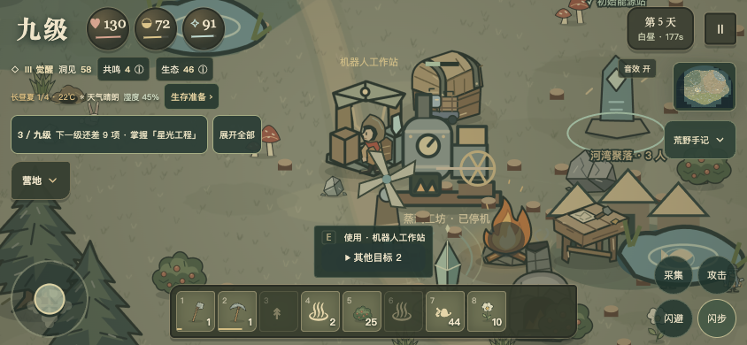

# 九级 4.1.0 · 夜行与火光

核对日期：2026-11-12。4.1 已发布腾讯云、GitHub、GitHub Pages 与官网，ZIP、Windows x64 与 macOS 双架构下载同步更新。公开源码及安装包基线为 `87769cb`，详见 [跨平台发行验收](跨平台发行/说明.md)。本轮不修改《大国崛起》、TapTap、uTools 或统信商店内容。下文保留开发阶段的规则与本地验收说明，公开状态以发行记录为准。

## 本轮采用的反馈

| 生灵 | 出现阶段 | 机制与应对 |
| --- | --- | --- |
| 影蝎 | 一级、第一天起 | 远处潜伏、近处显形；先标绿圈再留下 5 秒毒区，移开即可避让，光中免疫毒区伤害。 |
| 夜嚎者 | 二级、第二天起 | 240 步支援光环让附近其他夜怪伤害 +20%、速度 +10%，同类不叠加；击倒或逼入光中使光环失效。先标瞬移落点，瞬移本身不伤人。 |
| 碎骨野猪 | 一级、第三天起 | 锁定落点后冲锋，可侧移。成树会拦截冲锋，野猪硬直至少 2 秒；受击后玩家被推向树，会额外损失 4 生命、6 意识。树木只结算一次折断。 |
| 血蝠群 | 二级、第三天起 | 先标红圈，再产生 4 秒蝠雾。圈内意识消耗火外 1/秒、火内 0.5/秒；只轻染屏幕边缘，不遮住操作区。同类区域不叠加。 |
| 蚀者 | 四级、第六天起 | 吞火先蓄势 1.8 秒，任何命中都可打断；每 12 秒最多吞 8 燃料，释放时至少留下 8（营火之后仍自然燃烧）。不吞火炬、长明灯和自身心光；低血狂暴仍畏光，瞬移有落点预警。 |

所有新夜怪仍怕光；第一夜不会出现组合怪。总数上限四只，同时最多一个夜嚎者和一个蚀者。除低血狂暴的蚀者外，负伤夜怪会退去；离远后移除。不替换白昼、远征守卫及裂隙生物。

近战翻滚后 0.55 秒内攻击仍沿用 4.0 的双倍突进；弓与法杖不触发。本轮补上白昼林猪与碎骨野猪的逐段冲撞、树木阻挡和击退碰撞，不能隔树命中或撞出陆地。折断木料留在地面，亲手拾取后获得 3 木材、1 树枝，不直接发进背包；树木折断消耗生态 1.2，与亲手砍伐相同，不可反复刷同一棵树。

## 科技在先，蒸汽生产在后

三级 → 金属冶炼＋共生实践 → 在研究台旁研究「蒸汽传动」→ 建造蒸汽工坊。

- 研究消耗：4 铜锭、4 木板、10 洞见、3 共鸣；建造另外消耗 8 铜锭、8 木板、10 石料。
- 未研究时，合成卡只显示前置说明与科技树入口，没有建造按钮；创造模式也不绕过科技。
- 生产规则与操作入口再次核对解锁状态。没有该科技的存量工坊保留物资和在制品，停止加工，待研究后继续；停机、排余热及取物仍可用。
- 合法 4.0 存档中已经研究蒸汽科技的工坊保持可用，原有搬运和燃料链不变。

## 操作、图鉴与手机

- 保留点击资源自动走近采集；手采补上弯腰、探手，伐木采矿继续使用工具动作。保留采集键作为精确选择和触屏备用，没有加入走过就自动捡物。
- 夜间图鉴独立分类，亲自靠近遭遇后记录，无需击杀。未发现条目隐藏造型和名称，只给出现阶段及准备建议。生存准备可直接跳到展开后的夜间分类。
- 图鉴的地图和守卫数量改为从实际定义统计，避免沿用旧版的四图、三守卫计数。
- 不添加常驻战斗按钮。手机同时最多显示两条近处攻击说明，所有危险圈保留；文字不伸出画面，近处轮廓弱显。
- 390×844 竖屏、720×324 短横屏、844×390 横屏检查：无页面横向溢出，关闭按钮 44×44，内容独立滚动。

## 本轮没有采用或尚未做

- 不采用火外全局移速、武器耐久双重惩罚；原有缺光缓冲与伤害继续生效，血蝠的加倍只针对自己的意识扰动。
- 不删除采集键，不添加无提示强制自动采集，避免战斗、播种或靠近多个资源时误操作。
- 四季现象与树木分布延续 4.0；多树种、繁茂高树、树下灌木和潜行躲藏尚未新增，不能把已有季节色调称为完成这些需求。
- 未做手机真机、TapTap 宿主真机及长期平衡测试；五类生灵造型采用代码生成 SVG，不涉及 3D/WebGPU 改造。

## 验收

- 263 项单元/规则测试通过，含 12 项新的夜怪与蒸汽门槛测试；语法检查通过。
- 一级至九级旧成长与星海路线、六图前哨经营、正常资源蒸汽生产和搬运流程通过。
- 浏览器实际导入 4.0 正常资源存档；另用明确标注的构造状态检查未研究科技、已发现图鉴、夜间危险圈和吞火提示。
- 离线 ZIP 静态联网审计通过；浏览器 file:// 下断网启动并进入游戏通过。公开 ZIP 和桌面安装包另经跨平台构建与摘要校验；官网下载入口已更新。
- 本地预览：`JIUJI_PORT=4340 npm run dev`。
